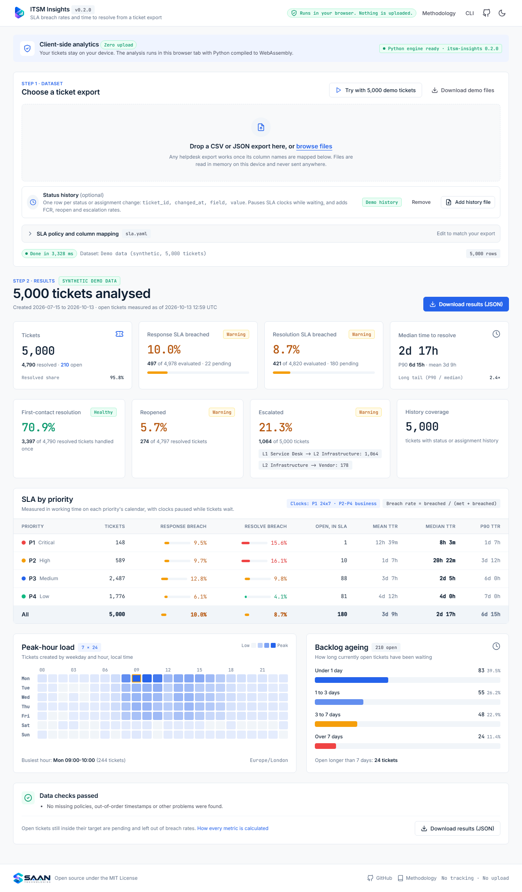

<div align="center">

<picture>
  <source media="(prefers-color-scheme: dark)" srcset="docs/images/itsm-insights-logo-dark.png">
  
</picture>

### Service-desk SLA analytics from a ticket export, in one command or one click

[](https://github.com/musaraza004/itsm-insights/actions/workflows/ci.yml)
[](https://musaraza004.github.io/itsm-insights/)


[](LICENSE)

**[Open the web app](https://musaraza004.github.io/itsm-insights/)** ·
[Quick start](#quick-start) ·
[Metrics](#metrics) ·
[Methodology](docs/METHODOLOGY.md) ·
[Roadmap](#roadmap)

</div>

<br>

<p align="center">
  <a href="https://musaraza004.github.io/itsm-insights/?demo=1">
    <picture>
      <source media="(prefers-color-scheme: dark)" srcset="docs/images/web-app-dark.png">
      
    </picture>
  </a>
</p>

## Overview

Most small and mid-size IT teams keep their tickets in Jira, ClickUp, Freshdesk or a
spreadsheet, but have no clear view of how they are performing. Enterprise reporting is
expensive or takes weeks to set up, so someone ends up counting tickets in Excel.

**ITSM Insights** reads the CSV or JSON export you already have and answers the questions
service managers are asked every week:

- **Are we meeting our SLAs**, and for which priorities do we fail?
- **How long do tickets really take** to resolve, and how bad is the long tail?
- **When does work arrive**, so shifts can be staffed to match?
- **How old is the backlog**, and what is going stale?

It ships as a Python package with a CLI, and as a [web app](https://musaraza004.github.io/itsm-insights/)
that runs the same package in your browser.

## Highlights

| | |
| --- | --- |
| **Private by design** | Everything runs locally. The web app executes Python in the browser via WebAssembly; tickets are never uploaded. No telemetry. |
| **Works with any export** | A small YAML file maps your column names. Clear errors name the missing column, the row and the bad value. |
| **Honest metrics** | Pending tickets are not counted as met, P90 sits next to the mean, and every exclusion is reported. Definitions are in [METHODOLOGY.md](docs/METHODOLOGY.md). |
| **Verified against known answers** | A synthetic data generator plants each ticket's SLA outcome, and the tests require the metrics to recover every one exactly. |

## Quick start

**In the browser** (nothing to install): open
[musaraza004.github.io/itsm-insights](https://musaraza004.github.io/itsm-insights/) and drop in an
export, or click *Try with 5,000 demo tickets*.

**From the command line:**

```bash
pip install git+https://github.com/musaraza004/itsm-insights.git
itsm-insights generate-demo --tickets 5000 --out demo.csv
itsm-insights analyze demo.csv
```

Example output (abridged; the demo data depends on the date it is generated):

```text
Response SLA breached:   9.3% (462 of 4,983)
Resolution SLA breached: 9.0% (437 of 4,858)

SLA and time to resolve by priority
| Priority | Tickets | Response | Resolve | Open,  |  Mean | Median |     P90 |
|          |         |   breach |  breach | in SLA |   TTR |    TTR |     TTR |
|----------+---------+----------+---------+--------+-------+--------+---------|
| P1       |     148 |     7.4% |   13.5% |      0 | 3h 4m |  2h 9m |  6h 25m |
| P2       |     589 |    11.0% |   18.1% |      4 | 7h 0m |  5h 2m | 17h 14m |
| ...      |         |          |         |        |       |        |         |
```

Useful options:

| Option | Purpose |
| --- | --- |
| `--config sla.yaml` | Your SLA targets and column mapping (see below) |
| `--json` | Machine-readable output, including the heatmap and backlog data |
| `--as-of now` | Measure open tickets against the current time instead of the export's latest timestamp |

## Using your own export

Most exports work as they are. When a configured column is missing, ITSM Insights looks for the
names Jira, ServiceNow, Zendesk, Freshdesk and ClickUp use (`Issue key`, `Created`, `Resolved`,
`opened_at`, `Solved at`, `Custom field (Customer Request Type)` and more), skips columns that are
empty, and tells you which ones it picked. It also:

- maps priorities like `High (P3)` or `P2 - High` to `P3` and `P2` automatically
- works out whether dates are day/month or month/day from the data
- reads only the columns it needs, so 700-column Jira exports load in seconds
- ignores date columns a spreadsheet app has damaged (times without dates, `#VALUE!`) instead
  of misreading them, and says so
- flags tickets whose status and resolved time disagree

To pin things down, copy [`examples/sla.yaml`](examples/sla.yaml) and edit it:

```yaml
timezone: Europe/London            # for timestamps without a UTC offset, and the heatmap

columns:                           # only needed when detection picks the wrong column
  id: Issue key
  created: Created
  resolved: Resolved

sla:                               # your real targets, one per priority
  P1: {response: 15m, resolve: 4h, calendar: 24x7}
  P2: {response: 1h,  resolve: 8h, calendar: 24x7}
  P3: {response: 4h,  resolve: 3d, calendar: 24x7}

priority_aliases: {Urgent: P1}     # names without a P-code
date_order: auto                   # or dmy / mdy for numeric dates like 05/08/2026
```

Durations accept `s`, `m`, `h`, `d` and `w`, and can be combined (`1h30m`).

> **Tip:** export straight from your service desk and upload that file. Opening an export in
> Excel and saving it again can strip seconds and turn date columns into bare times.

## Metrics

| Metric | Definition |
| --- | --- |
| **Response SLA breach rate** | Share of tickets whose first response came after the target for their priority. A ticket resolved with no recorded response counts as answered at resolution. |
| **Resolution SLA breach rate** | Share of tickets resolved after the target for their priority. |
| **Time to resolve** | Created to resolved, as mean, median and P90. The median and P90 are the honest numbers; a few stale tickets inflate the mean. |
| **Peak-hour load** | Tickets created by weekday and hour in local time, shown as a 7 × 24 heatmap. |
| **Backlog ageing** | Open tickets by age: under 1 day, 1 to 3 days, 3 to 7 days, over 7 days. |

How SLA outcomes are counted:

- **Breach rate = breached / (met + breached).** Open tickets still inside their target are
  *pending* and excluded, because counting them as met would flatter the result.
- An open ticket already past its target counts as **breached** at the analysis time.
- Exactly on target counts as **met**.
- Tickets with no SLA for their priority, or with timestamps out of order, are excluded and
  reported as warnings, never dropped silently.

## How it is validated

Real tickets are never used. `itsm-insights generate-demo` builds a synthetic service desk:
arrivals follow office hours with a Monday-morning spike, categories mirror a typical L1 queue
(password resets, VPN, printers), and recent tickets are still open at export time.

The generator decides each ticket's SLA outcome *before* it creates the timestamps, so it knows
the right answer. The test suite checks that the metrics reproduce every planted outcome exactly,
alongside boundary tests (exactly on target, one second over, open tickets, mixed time zones).
Run `generate-demo --truth` to see the planted outcomes yourself.

## Project structure

```text
src/itsm_insights/
├── cli.py              # analyze and generate-demo commands
├── config.py           # YAML config: SLA policies, column mapping (Pydantic)
├── loaders/generic.py  # CSV/JSON loading, timestamp normalisation, validation
├── metrics/            # sla.py, mttr.py, load.py, backlog.py
├── analysis.py         # runs every metric, collects warnings
└── generator.py        # synthetic tickets with planted outcomes
web/                    # the browser app (Pyodide + anime.js), deployed to GitHub Pages
docs/METHODOLOGY.md     # exact metric definitions and the reasoning behind them
tests/                  # pytest suite
```

## Roadmap

- [x] **v0.1** CSV/JSON loader, SLA breach rates (24x7), time to resolve, synthetic generator,
  CLI, browser app, peak-hour heatmap, backlog ageing
- [ ] **v0.2** Business-hours calendars (working hours, weekends, holidays, time zones), SLA clock
  pausing from status history, first-contact resolution, reopen and escalation rates
  ([design](docs/superpowers/specs/2026-10-13-v0.2-design.md))
- [ ] **v0.3** Repeat incident detection, Jira and ClickUp loaders
- [ ] **v0.4** Self-contained HTML report, Docker image
- [ ] **v1.0** Documentation site, PyPI release

## Development

```bash
git clone https://github.com/musaraza004/itsm-insights.git
cd itsm-insights
python -m venv .venv
.venv/bin/pip install -e ".[dev]"     # Windows: .venv\Scripts\pip install -e ".[dev]"
pytest
ruff check . && ruff format --check .
```

To work on the web app locally, build the wheel next to the page and serve the folder:

```bash
mkdir -p _site && cp -r web/. _site/ && pip wheel . --no-deps -w _site
echo '{"wheel": "itsm_insights-0.1.0-py3-none-any.whl", "version": "0.1.0"}' > _site/manifest.json
python -m http.server 8765 --directory _site
```

## Contributing

Contributions are welcome. Please read [CONTRIBUTING.md](CONTRIBUTING.md); in short, never commit
real ticket data, and add a test with a hand-checked expected value for any change to the time
logic.

## License

Released under the [MIT License](LICENSE).

<br>

<div align="center">
  <picture>
    <source media="(prefers-color-scheme: dark)" srcset="docs/images/saan-technologies-logo-dark.png">
    
  </picture>
  <br>
  <sub>Built by SAAN Technologies</sub>
</div>
